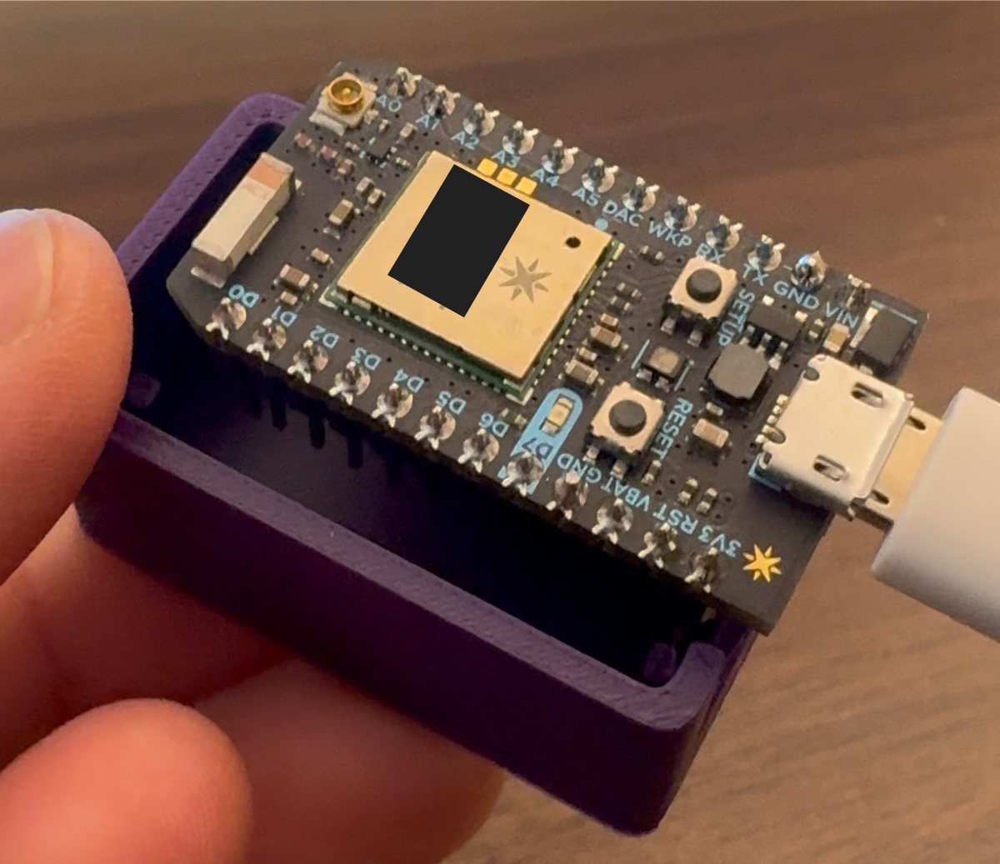

# pi-light

A USB desk light for [OMP](https://github.com/can1357/oh-my-pi). The built-in RGB LED on an original Particle Photon shows whether your agent is working, needs input, has finished, or hit a run error.


You need a Photon and a data-capable micro-USB cable. No extra electronics, Wi-Fi setup, or Particle cloud account is required. The host bridge sends status over USB; the enclosure is optional.

## Compatibility

- **Original Particle Photon only:** Gen 2, STM32F205, platform 6. Photon 2/P2, Boron, Spark Core, and ESP32 are not compatible with this firmware.
- The supported setup is macOS with OMP's default user profile. The installer does not configure named profiles or other agent CLIs.
- Firmware builds use a pinned macOS x86_64 compiler. Intel Macs can run it directly; Apple Silicon needs existing x86 translation support. Setup checks the compiler but does not install Rosetta or change security settings.

## What the light means

| State | Light |
| --- | --- |
| Working | Slow blue breath |
| Needs input (`waiting`) | Amber pulse during an OMP question, tool approval, or plan review |
| Complete (`done`) | Three green flashes, then steady green |
| Run error | Repeating red double pulse |
| Idle | Very dim steady white |
| Host link lost (`offline`) | Slow dim-white breath after 15 seconds without a valid device heartbeat |

Across live top-level sessions, priority is **waiting > error > working > done > idle**. A completed session cannot hide another session that is still working. Root sessions include their continuing background work; subagents do not publish independently. Completion and run errors remain until new work starts or the session closes. A user-aborted run becomes idle. A failed tool call that the agent is recovering from does not by itself mean the run failed.

The light never answers questions or approves tools. Free-form prose questions are not detected. macOS permission dialogs, terminal password prompts, and third-party applications do not necessarily emit OMP events. Photon boot, listening, and DFU colors are device status, not pi-light states.

## Install

### Prerequisites

Install these before starting:

- [OMP](https://github.com/can1357/oh-my-pi#install), with the public question, approval, plan-review, and terminal-run extension events used by this project. The repository does not pin an OMP version; older versions may lack these events.
- [uv](https://docs.astral.sh/uv/getting-started/installation/) for the Python 3.11 environment below. The host dependency is pinned to `pyserial==3.5` in `requirements.txt`.
- [Node.js](https://nodejs.org/) **22.23.4 or newer** and [Bun](https://bun.sh/docs/installation) with text-lockfile support, for firmware tooling and extension tests.
- `git`, `curl`, `tar`, `shasum`, GNU `make`, `crc32`, and `xxd`. Apple's [Command Line Tools](https://developer.apple.com/xcode/resources/) provide the compiler and build tools; the firmware preparation script checks the required commands.
- [Particle CLI](https://docs.particle.io/getting-started/developer-tools/cli/) for local USB flashing. It is separate from the firmware build tools. See the [firmware guide](docs/FIRMWARE.md) for installation, device selection, and upgrade precautions.

Internet access is needed to download dependencies and official firmware components. Normal operation uses only local IPC and USB.

### 1. Clone and build

Choose a checkout path **without spaces**, as required by Particle's Device OS 2.x makefiles:

```sh
git clone https://github.com/GitAashishG/pi-light.git
cd pi-light
uv venv --python 3.11 .venv
uv pip install --python .venv/bin/python -r requirements.txt
bash scripts/build-firmware.sh
```

The build downloads pinned Device OS 2.3.1 sources, Arm GCC 9.2.1, and official Photon system modules into `firmware/.tools/`. It produces `firmware/build/pi-light.bin` and a module-validation report. It does not flash, reset, or open a device.

### 2. Install the Photon firmware

Follow [Build and flash the Photon](docs/FIRMWARE.md) before continuing. The application requires system part 2 version **2302 or newer** and a compatible system/bootloader set; the official 2.3.1 system pair requires bootloader **1003 or newer**. Flashing only the application onto an old Photon is not enough.

Use the guide's explicit device selection. Do not select another serial board or use raw bootloader DFU writes.

### 3. Install the host integration

From the checkout:

```sh
.venv/bin/python scripts/install.py
export PATH="$HOME/.local/bin:$PATH"
```

The `export` applies to this terminal only; no shell startup file is edited. You can instead run `~/.local/bin/pi-light` wherever this guide says `pi-light`.

The installer creates an OMP loader at `~/.omp/agent/extensions/pi-light.ts` and the command at `~/.local/bin/pi-light`. Both point into this checkout, so keep the checkout and `.venv` in place. It refuses to overwrite unrelated or modified installation targets and leaves other integrations and approval settings alone.

Connect the flashed Photon and start a new default-profile OMP session. Its first indicator event starts the bridge automatically; allow a few seconds for the initial heartbeat. **Restart or explicitly reload existing sessions** to load the extension. The bridge is a detached process, not a login service.

```sh
pi-light status
pi-light query
```

`status` returns the aggregate session state and cached device health. `query` requests a fresh device acknowledgment and fails if the device is unavailable; it does not refresh the firmware watchdog. Check `device.connected` as well as `aggregate`: a working host session does not prove the Photon is connected.

## Everyday use

Leave the Photon plugged in while using OMP. Session heartbeats run every three seconds, and a crashed publisher's lease expires after twelve seconds. The bridge reconnects after USB is unplugged and restored. If the bridge stops sending valid heartbeats, a powered Photon changes to offline after fifteen seconds rather than displaying stale success.

To run the bridge yourself, without opening OMP:

```sh
pi-light serve
```

This stays in the foreground. Use a second terminal for diagnostics and notifications. Only one bridge can own the runtime directory and USB connection.

### Manual light test

With a bridge running, send a short-lived notification:

```sh
session="desk-test:$(uuidgen)"
pi-light notify waiting --session "$session" --seq 1
pi-light query
sleep 3
pi-light remove --session "$session" --seq 2
```

The three-second pause gives you time to see the amber pulse. Each update leases the state for twelve seconds unless refreshed. Use a new session ID for each test, or keep increasing `--seq` for an existing ID; duplicate or older sequence numbers are rejected. The test participates in normal session priority and does not override higher-priority publishers. Other accepted states are `working`, `done`, `error`, and `idle`.

### Brightness and stopping

Brightness is a bridge startup setting, not a live command. The default is 48; the range is 0–128, with 0 turning off all patterns, including offline.

First close all OMP sessions using the extension and stop any other publishers. Even an idle open session sends heartbeats and can restart a stopped bridge. Then run:

```sh
pi-light stop
sleep 4
pi-light serve --brightness 24
```

The pause lets the old serial owner shut down. Wait for `serve` to stay running before reopening OMP, and leave that terminal open; Ctrl-C stops it. The next automatic start uses the default brightness again. If `serve` reports `already-running`, another bridge won ownership, so its settings still apply. `pi-light stop` stops only this user's bridge, not OMP or its sessions.

## Hardware and enclosure

The Photon uses its onboard RGB LED and gets power and data from USB. There is no wiring step or external LED strip.



The interior photo shows board orientation and cable clearance. **Unplug USB before fitting or removing the board.** Keep pins clear of the case floor and avoid side loads on the USB socket.

The pictured enclosure is optional. The [enclosure guidance](docs/ENCLOSURE.md) covers diffuser material, board clearance, cable strain relief, and recovery-button access. Check the fit of your board, header pins, cable, and lid before using a case; the pictured prototype does not establish fit for every printer or Photon variant. Keep SETUP and RESET accessible through a removable lid or service openings.

## Troubleshooting

| Symptom | Check |
| --- | --- |
| `pi-light: command not found` | Use `~/.local/bin/pi-light`, or add `~/.local/bin` to this terminal's `PATH` as above. |
| `bridge-unavailable` | Diagnostics do not autostart the bridge. Start a newly loaded OMP session or run `pi-light serve` in another terminal. Check that the checkout and `.venv` still exist. |
| Device disconnected, `device-unavailable`, or `device-timeout` | Use a data cable, close serial monitors, and check that the board runs pi-light rather than listening/DFU mode. Automatic discovery requires exactly one original-Photon USB serial candidate. Reconnect after flashing and handle any macOS accessory approval yourself. |
| `already-running` when changing brightness | Close publishers before `stop`; otherwise their next heartbeat can autostart the default bridge. |
| Light does not match this session | Check `status` for other live publishers. Waiting and error take precedence over working; completed sessions stay green until new work or closure. Reload older OMP sessions if events are missing. |
| `stale-sequence` | Use a fresh opaque session ID or a sequence number newer than all updates and removals for that ID. |
| `unsafe-state-path` | Inspect ownership, permissions, and symlinks under `~/.local/state/pi-light`. Do not delete a live socket or loosen permissions to bypass the check. |
| Photon shows safe-mode or boot colors | Check the system/bootloader dependencies in the [firmware guide](docs/FIRMWARE.md). These are not agent states. |

For serial diagnosis, set `PHOTON_PORT` to the exact path reported for your Photon, then use `pi-light serve --port "$PHOTON_PORT"`. This still requires the pi-light handshake. Do not guess a port or point it at unrelated hardware.

## Local API and privacy

The bridge listens on a private Unix socket at `~/.local/state/pi-light/bridge.sock`, not TCP. The directory is mode 0700 and the socket is 0600. The extension sends an opaque session ID, state, and sequence number; the Photon receives only aggregate state, sequence, and brightness. This project does not send prompts, code, paths, credentials, or tool arguments to the board or log those payloads. Device status includes the Photon ID, so redact diagnostic output before sharing it.

See [PROTOCOL.md](PROTOCOL.md) for the bounded JSONL and USB interfaces. Other clients can publish through these interfaces, but the installer supplies no non-OMP hooks.

## Uninstall

Close OMP sessions using the extension first so they cannot restart the bridge. From the checkout:

```sh
~/.local/bin/pi-light stop
.venv/bin/python scripts/install.py --uninstall
```

If the bridge is already stopped, the first command may report `bridge-unavailable`; proceed with uninstall. The installer removes only its managed loader, command, and receipt, and preserves modified targets. Firmware, source, dependencies, and unrelated integrations remain. The Photon stays flashed; unplug it if you no longer want the indicator powered.

## Contributing

From the checkout with the dependencies installed:

```sh
.venv/bin/python -m unittest discover -s tests/host -p 'test_*.py' -v
bun test tests/extension.test.ts
make -C tests/firmware test
```

The native firmware tests need a C++14 compiler with AddressSanitizer and UndefinedBehaviorSanitizer, plus `python3` on `PATH`. They do not need the Particle SDK or a board.

The OMP integration fixtures use a deterministic local provider rather than a paid model. **Unplug the Photon before running these isolated-runtime tests:** their test bridges can still discover a connected board. After installing the loader, run:

```sh
.venv/bin/python tests/runtime-smoke.py --installed
.venv/bin/python tests/async-runtime.py
```

To test deliberately against the normal bridge and real light, use `--live-bridge` instead, with no other publishers active. Those runs briefly control the light and require a working Photon connection. See [firmware/BUILD.md](firmware/BUILD.md) for low-level build pins, module layout, and firmware internals.
