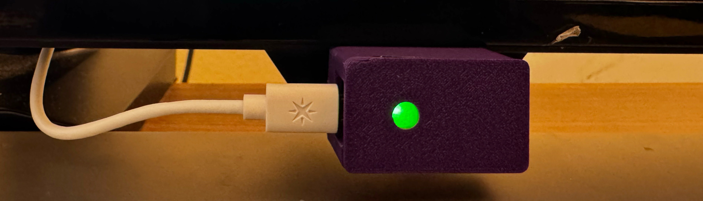

# pi-light

pi-light shows when your [OMP](https://github.com/can1357/oh-my-pi) coding agent needs you, without switching back to the terminal. An original Particle Photon plugs into your Mac over USB and displays the session state on its built-in RGB LED.

[](https://youtu.be/SE3suwZFlJ4)

[Watch the 1-minute demo on YouTube](https://youtu.be/SE3suwZFlJ4)

## What the light means

| Light | Agent state |
| --- | --- |
| Blue, slowly pulsing | Working |
| Amber, pulsing | Waiting for an answer, tool approval, or plan review |
| Three green flashes, then steady green | Finished |
| Repeating red double pulse | Run ended with an error |
| Dim white, steady | Idle |
| Dim white, slowly pulsing | No valid USB heartbeat for 15 seconds |

With multiple sessions open, the light shows the highest-priority state: **waiting > error > working > done > idle**. A finished session cannot hide a question in another terminal. The extension listens to OMP events; it does not read prompts or infer a question from conversation text.

## Prerequisites

- **Hardware:** an original Particle Photon (Gen 2, STM32F205, platform 6) and a **data-capable micro-USB cable**. The Photon 2/P2 uses different firmware. The printed case is optional; no wiring, external LED, or soldering is needed.
- **Host:** macOS, [OMP](https://github.com/can1357/oh-my-pi#install) with question, approval, plan-review, and terminal-run events, and [uv](https://docs.astral.sh/uv/getting-started/installation/) for the Python 3.11 bridge. The installer targets OMP’s default profile.
- **Firmware build:** Apple Command Line Tools, [Node.js](https://nodejs.org/) 22.23.4 or newer, [Bun](https://bun.sh/docs/installation), and `git`, `curl`, `tar`, `shasum`, GNU `make`, `crc32`, and `xxd` on `PATH`. On Apple Silicon the bundled x86_64 toolchain requires Rosetta.
- **Flashing:** [Particle CLI](https://docs.particle.io/getting-started/developer-tools/cli/). No Particle account, device claim, or Wi-Fi setup is required.

## Installation

### 1. Clone and build

Use a checkout path **without spaces**. The Device OS 2.x makefiles do not support them.

```sh
git clone https://github.com/GitAashishG/pi-light.git
cd pi-light
uv venv --python 3.11 .venv
uv pip install --python .venv/bin/python -r requirements.txt
bash scripts/build-firmware.sh
```

The script downloads the pinned Device OS 2.3.1 sources and Arm GCC 9.2.1, then writes `firmware/build/pi-light.bin`. Building does not flash the board.

### 2. Flash the original Photon

Follow [Build and flash the Photon](docs/FIRMWARE.md) to identify your board, inspect its installed modules, and choose the correct flash command. On a compatible board, only the application needs replacing. Older boards may need a Device OS or bootloader update. Do not disconnect power during a flash.

### 3. Install the host integration

```sh
.venv/bin/python scripts/install.py
export PATH="$HOME/.local/bin:$PATH"
```

Keep the checkout and `.venv` in place. The installer creates `~/.omp/agent/extensions/pi-light.ts` and `~/.local/bin/pi-light`, both of which refer to this checkout. Add the `PATH` entry to your shell profile if needed.

Connect the flashed Photon and start a new OMP session, or reload the extension in an existing one. The extension starts the USB bridge automatically. After a few seconds, run:

```sh
pi-light status
pi-light query
```

`status` shows the aggregate session state and cached device information. `query` asks the board for a fresh acknowledgment. Look for `device.connected: true`; an aggregate state alone does not confirm a USB connection.

### Manual light test

With the bridge running, request an amber pulse for three seconds:

```sh
session="desk-test:$(uuidgen)"
pi-light notify waiting --session "$session" --seq 1
pi-light query
sleep 3
pi-light remove --session "$session" --seq 2
```

The last command removes the test session and restores the normal aggregate state. To test without OMP, first run `pi-light serve` in a separate terminal.

## Print and assemble the enclosure

1. Download the [USB-end tray](docs/print/fit_base.stl) and [lid fit piece](docs/print/fit_lid.stl). Print them at 100% scale in millimeters and check your board, header pins, and cable plug.
2. Print the [full tray](docs/print/base.stl) floor-down and the [lid](docs/print/lid.stl) outside-face-down in nonconductive filament.
3. **Unplug USB.** Fit a small piece of translucent material into the recess behind the lid’s round window. Seat the Photon with its micro-USB socket facing the cable opening and its RGB LED under the window.
4. Fit the lid, reconnect the cable, and run the [manual light test](#manual-light-test). Keep the lid removable so you can reach SETUP and RESET.


See the [enclosure guide](docs/ENCLOSURE.md) for dimensions, print settings, and clearance checks.

## Brightness and stopping

Brightness is set when the bridge starts. The default is `48`; the range is `0` (off) to `128`. To change it, close OMP sessions using pi-light and stop any other publishers, then run:

```sh
pi-light stop
sleep 4
pi-light serve --brightness 24
```

Leave `serve` running while you use that setting. Ctrl-C stops it. A new OMP session can start the bridge again with the default brightness.

## Troubleshooting

| Symptom | What to check |
| --- | --- |
| `pi-light: command not found` | Run `~/.local/bin/pi-light`, or add `~/.local/bin` to `PATH`. |
| `bridge-unavailable` | Start a new OMP session or run `pi-light serve`. The diagnostic commands do not start the bridge. |
| `device-unavailable` or `device-timeout` | Use a data cable, close serial monitors, and check that the Photon is running pi-light firmware. Automatic discovery expects exactly one original Photon. |
| Light shows an unexpected state | Check `pi-light status` for other active sessions. Photon boot, listening, and DFU patterns are separate from pi-light states. |

For port selection, reconnect behavior, or bridge errors, see [Operating pi-light](docs/OPERATIONS.md). For the session and USB message formats, see the [protocol reference](PROTOCOL.md).

## Uninstall

Close OMP sessions using pi-light, then run these commands from the checkout:

```sh
~/.local/bin/pi-light stop
.venv/bin/python scripts/install.py --uninstall
```

If the bridge is already stopped, continue with `--uninstall`. This removes the host command and OMP loader. It does not erase the firmware on the Photon.

## Contributing

Run the host, extension, and native firmware tests from the checkout:

```sh
.venv/bin/python -m unittest discover -s tests/host -p 'test_*.py' -v
bun test tests/extension.test.ts
make -C tests/firmware test
```

The native firmware tests require a C++14 compiler with AddressSanitizer and UndefinedBehaviorSanitizer. They do not require a board. See [Operating pi-light](docs/OPERATIONS.md) for OMP integration tests and [firmware build details](firmware/BUILD.md) for the module layout and toolchain pins.
